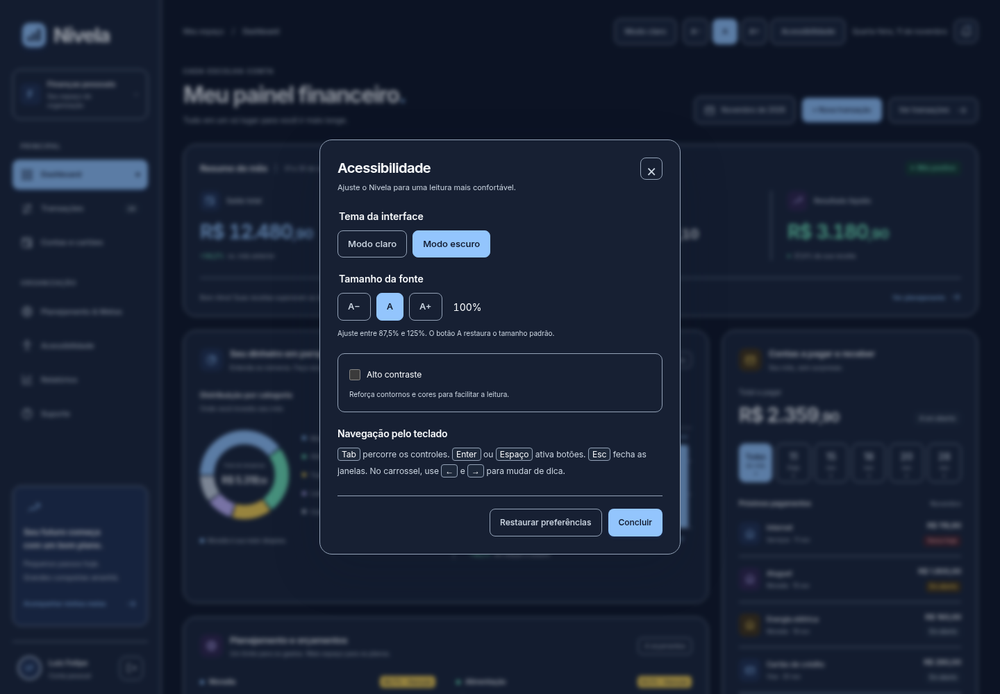

<div align="center">

  <a href="https://luizfelip-dev.github.io/website/login.html">
    
  </a>

  <h1>Nivela — Controle Financeiro</h1>

  <p><strong>Mais clareza para o seu dinheiro. Mais espaço para os seus planos.</strong></p>
  <p>Um painel de finanças pessoais feito com HTML, CSS e JavaScript puro.</p>

  <p>
    
    &nbsp;&nbsp;
    
    &nbsp;&nbsp;
    
  </p>

  <p>
    <a href="https://luizfelip-dev.github.io/website/login.html"><strong>Abrir o Nivela ↗</strong></a>
    &nbsp; · &nbsp;
    <a href="#telas-do-projeto">Ver as telas</a>
    &nbsp; · &nbsp;
    <a href="#sua-conta-e-seus-dados">Sua conta e seus dados</a>
  </p>

  <picture>
    <source media="(prefers-color-scheme: dark)" srcset="docs/readme/painel-escuro.png">
    <source media="(prefers-color-scheme: light)" srcset="docs/readme/painel-claro.png">
    
  </picture>

</div>

## A ideia por trás do Nivela

Abrir o painel e entender como está o mês, sem precisar procurar cada informação em um lugar diferente. Essa foi a ideia que guiou o Nivela: reunir saldo, despesas, contas e planos em uma interface fácil de consultar.

O projeto nasceu no trabalho final de **Desenvolvimento de Interfaces do CEUB**. Começou com a estrutura em HTML e CSS e foi ganhando filtros, formulários, cálculos e opções de acessibilidade. Tudo foi construído com recursos nativos da web, sem frameworks de interface ou bibliotecas de gráficos.

## O que dá pra fazer

| No Nivela | Como funciona |
| --- | --- |
| **Resumo do mês** | Consultar pagamentos e recebimentos do mês e o saldo acumulado, com atualização após cada lançamento confirmado. |
| **Contas a pagar e receber** | Filtrar os vencimentos e confirmar pagamentos ou recebimentos, usando os mesmos dados da tabela. |
| **Busca de movimentações** | Combinar filtros de receitas e despesas com uma pesquisa por descrição ou categoria, sem se preocupar com acentos. |
| **Novas transações** | Criar, editar e excluir receitas, despesas e transferências; dividir uma compra em **2 a 24 parcelas** ou repetir um lançamento por **12 meses**. |
| **Orçamentos e metas** | Definir limites por categoria, receber alertas a partir de **80% e 100%** e criar metas com o valor que você já guardou. |
| **Educação financeira** | Navegar por dicas com ilustrações próprias, controles de anterior/próximo e pausa da rotação. |
| **Preferências de leitura** | Escolher tema claro ou escuro, ativar alto contraste e ajustar a fonte de **87,5% a 125%**. |
| **Entrada e suporte** | Criar conta com usuário e senha, entrar com autenticação real e registrar uma mensagem de suporte. |

Os lançamentos, limites e metas ficam salvos no Supabase, separados por conta. As preferências de leitura continuam no navegador. Sair encerra a sessão e preserva seus dados.

## Telas do projeto

O painel tem versões clara e escura, e as opções de leitura também estão disponíveis no login. As capturas ilustram a interface; uma conta nova começa com os valores zerados.

<details>
  <summary><strong>Ver login e painel de acessibilidade</strong></summary>

  <br>

  | Entrada | Acessibilidade |
  | :---: | :---: |
  |  |  |

  As janelas fecham por botão, pela tecla `Esc` ou pelo clique fora. Ao fechar, o foco retorna ao controle que abriu a janela.

</details>

<details>
  <summary><strong>Ver a versão para celular</strong></summary>

  <br>

  <p align="center">
    
  </p>

  Os cartões se reorganizam em telas menores. A tabela mantém sua própria rolagem horizontal para não deslocar a página inteira.

</details>

## Por trás da interface

O **HTML5** organiza a navegação, os cartões, os formulários e os modais com elementos semânticos. O **CSS3** cuida do layout em Grid e Flexbox, dos temas e dos gráficos: a rosca usa `conic-gradient`, e as barras variam de altura conforme os dados. O **JavaScript** conecta as interações e atualiza a página sem recarregar. O **Supabase** fornece autenticação, banco PostgreSQL e a função de cadastro executada no servidor. A integração usa APIs REST e não carrega SDK ou framework no navegador.

Algumas escolhas que fazem diferença no uso:

- Os valores são calculados em **centavos inteiros**. Uma compra de R$ 100,00 em três parcelas fica em R$ 33,34 + R$ 33,33 + R$ 33,33, preservando o total.
- Lançamentos do tipo Transferência **não entram em receitas ou despesas** e não alteram o saldo total.
- O resumo usa os pagamentos e recebimentos confirmados do mês. O saldo inclui o histórico anterior, e os orçamentos também consideram despesas previstas.
- Status combinam texto e cor. O foco é visível, as imagens têm descrições e o carrossel respeita `prefers-reduced-motion`.
- A fonte Inter, as ilustrações, os scripts e os estilos são carregados de arquivos locais.

<details>
  <summary><strong>Conhecer a organização dos arquivos</strong></summary>

```text
website/
├── index.html                 # Dashboard
├── login.html                 # Entrada
├── README.md
├── .nojekyll
├── assets/
│   ├── css/
│   │   ├── style.css          # Layout, componentes e temas
│   │   ├── auth.css           # Formulários de acesso
│   │   └── dashboard.css      # Controles do painel
│   ├── js/
│   │   ├── app.js             # Transações, filtros, cálculos e suporte
│   │   ├── config.js          # URL e chave publicável do projeto
│   │   ├── session.js         # Autenticação, tokens e saída
│   │   ├── data.js            # Leitura e gravação por usuário
│   │   ├── login.js           # Formulário de entrada
│   │   ├── carousel.js        # Navegação e pausas das dicas
│   │   └── accessibility.js   # Tema, fonte e contraste
│   ├── img/                   # Ilustrações SVG próprias
│   ├── fonts/                 # Inter e sua licença
│   └── favicon.svg
├── supabase/
│   ├── schema.sql             # Tabelas e políticas de acesso
│   ├── username-auth.sql      # Cadastro e limites de tentativas
│   └── functions/nivela-auth/ # Cadastro executado no servidor
├── tests/                     # Testes locais de autenticação e dados
└── docs/
    └── readme/                # Capturas de tela e ícones das tecnologias
```

</details>

## Sua conta e seus dados

O cadastro pede **usuário, senha e confirmação da senha**, sem coletar e-mail. O usuário aceita de 3 a 24 letras sem acento, números e `_`. A senha precisa ter pelo menos 8 caracteres. Guarde essas informações: esta versão não oferece recuperação por e-mail.

A criação da conta passa por uma função no servidor. Ela verifica os dados e limita as tentativas por IP e navegador, com contagem persistida no banco. Apagar o armazenamento do navegador não remove o limite de IP. As políticas de **Row Level Security (RLS)** controlam o acesso aos dados financeiros de cada pessoa; a chave publicável do front-end não dá acesso às contas de outros usuários.

O banco está em um projeto dedicado no plano gratuito. As instruções técnicas de configuração e os limites do cadastro estão em [supabase/README.md](supabase/README.md). Para verificar o cliente sem conectar dados reais, consulte [tests/README.md](tests/README.md).

## Sobre esta versão

O Nivela continua sendo um **projeto acadêmico**, agora com autenticação e persistência remotas. Você pode consultar outros meses, configurar seu saldo inicial e acompanhar contas pendentes. As metas registram seu planejamento; elas não realizam transferências bancárias. O suporte grava a mensagem no banco, sem enviar e-mail automaticamente.

## Próximas ideias

- [ ] Exportar movimentações e relatórios.
- [ ] Acrescentar outros meios de recuperação de conta.
- [ ] Permitir gerenciar contas e carteiras separadamente.

## Quem fez

**Autor:** Luiz Felipe Ribeiro de Mello

Trabalho final de **Desenvolvimento de Interfaces (2/2026)**, no **CEUB — Centro Universitário de Brasília**, com o **Prof. Dr. Felipe Batista da Silva**.

[Meu perfil no GitHub ↗](https://github.com/luizfelip-dev)

As capturas mostram o próprio projeto. Os ícones de HTML, CSS e JavaScript vêm do [Devicon](https://github.com/devicons/devicon), com a [licença preservada aqui](docs/readme/tecnologias/LICENSE). A tipografia é a [Inter](https://github.com/rsms/inter), com a licença em [assets/fonts/OFL.txt](assets/fonts/OFL.txt).

---

<p align="center">
  <strong>Nivela</strong><br>
  Mais clareza. Mais possibilidades.<br><br>
  <a href="https://luizfelip-dev.github.io/website/login.html">Conhecer o projeto ↗</a>
</p>
