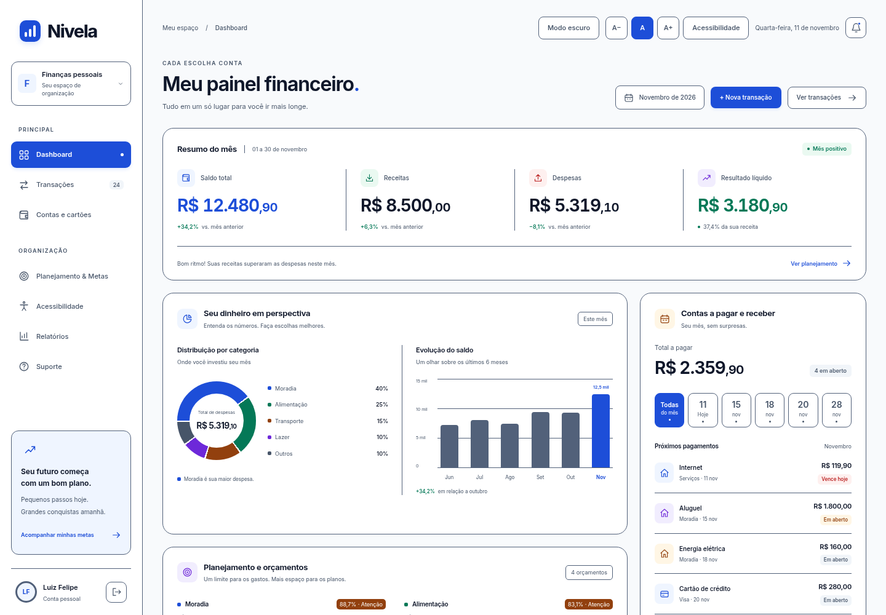
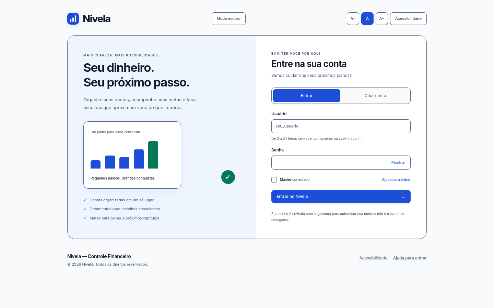
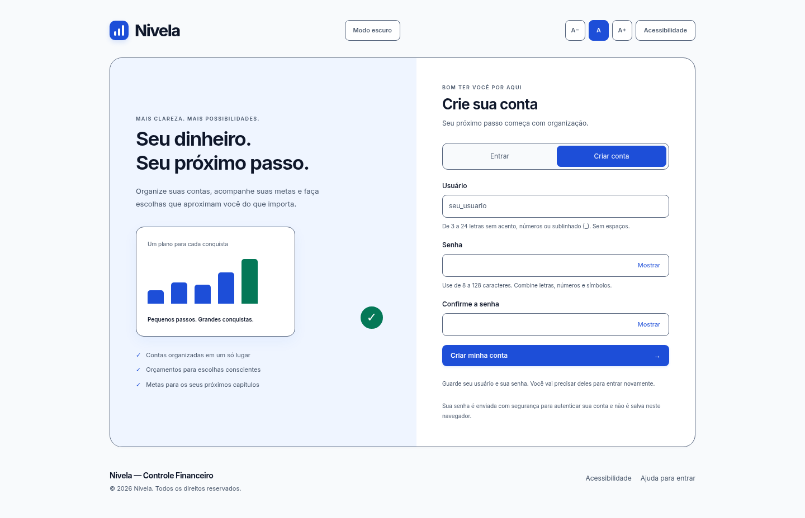
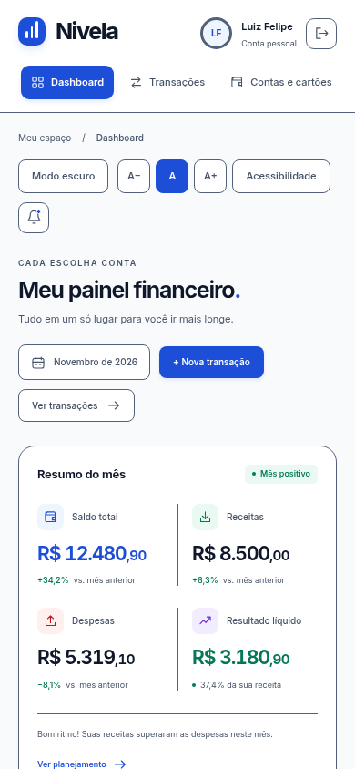

<div align="center">

  <a href="https://luizfelip-dev.github.io/website/login.html">
    
  </a>

  <h1>Nivela — Controle Financeiro</h1>

  <p><strong>Mais clareza para o seu dinheiro. Mais espaço para os seus planos.</strong></p>
  <p>Finanças pessoais com conta própria, dados salvos no Supabase<br>e uma interface feita com HTML, CSS e JavaScript puro.</p>

  <p>
    
    &nbsp;&nbsp;
    
    &nbsp;&nbsp;
    
  </p>

  <p>
    <a href="https://luizfelip-dev.github.io/website/login.html"><strong>Abrir o Nivela ↗</strong></a>
    &nbsp; · &nbsp;
    <a href="#telas-do-projeto">Ver as telas</a>
    &nbsp; · &nbsp;
    <a href="#sua-conta-e-seus-dados">Sua conta e seus dados</a>
    &nbsp; · &nbsp;
    <a href="#documentação-e-verificações">Documentação</a>
  </p>

  <picture>
    <source media="(prefers-color-scheme: dark)" srcset="docs/readme/painel-escuro.png">
    <source media="(prefers-color-scheme: light)" srcset="docs/readme/painel-claro.png">
    
  </picture>

</div>

## A ideia por trás do Nivela

Abrir o painel e entender como está o mês, sem precisar procurar cada informação em um lugar diferente. Essa foi a ideia que guiou o Nivela: reunir saldo, despesas, contas e planos em uma interface fácil de consultar.

O projeto nasceu no trabalho final de **Desenvolvimento de Interfaces do CEUB**. Começou com a estrutura em HTML e CSS, ganhou interatividade com JavaScript e passou a ter cadastro, autenticação e banco de dados no Supabase. A interface continua usando recursos nativos da web, sem frameworks, bibliotecas de gráficos ou CDNs.

Hoje, cada pessoa cria sua própria conta e começa com o painel zerado. Os lançamentos ficam vinculados ao usuário no banco, então é possível sair, voltar depois ou acessar em outro navegador sem perder o que foi registrado.

## Seu primeiro acesso

[Abra o Nivela](https://luizfelip-dev.github.io/website/login.html), escolha **Criar conta** e informe um usuário, uma senha e a confirmação da senha. Não precisa fornecer e-mail. Depois do cadastro, você entra no painel e pode configurar seu saldo inicial, registrar as primeiras movimentações e definir seus orçamentos.

Se já tiver uma conta, basta usar a opção **Entrar**. Marcar **Manter conectado** permite guardar a sessão entre visitas naquele navegador. As opções de tema, contraste e tamanho da fonte ficam disponíveis antes mesmo de entrar.

## O que dá pra fazer

| No Nivela | Como funciona |
| --- | --- |
| **Resumo do mês** | Escolher o mês e acompanhar saldo total, receitas, despesas e resultado líquido com base nos pagamentos e recebimentos confirmados. |
| **Contas a pagar e receber** | Filtrar os vencimentos e confirmar pagamentos ou recebimentos, usando os mesmos dados da tabela. |
| **Busca de movimentações** | Combinar filtros de receitas e despesas com uma pesquisa por descrição ou categoria, sem se preocupar com acentos. |
| **Transações completas** | Criar, editar e excluir receitas, despesas e transferências; marcar como pago ou pendente; dividir uma compra em **2 a 24 parcelas** ou repetir um lançamento por **12 meses**. |
| **Orçamentos e metas** | Definir limites por categoria, receber alertas a partir de **80% e 100%** e criar metas com o valor que você já guardou. |
| **Educação financeira** | Navegar por dicas com ilustrações próprias, controles de anterior/próximo e pausa da rotação. |
| **Preferências de leitura** | Escolher tema claro ou escuro, ativar alto contraste e ajustar a fonte de **87,5% a 125%**. |
| **Perfil e suporte** | Ajustar o nome exibido e o saldo inicial, além de registrar uma mensagem de suporte e receber seu protocolo. |

O que aparece na agenda, nos gráficos e na tabela vem dos mesmos lançamentos. Uma conta marcada como paga atualiza o painel sem precisar cadastrar a informação de novo em outro lugar.

## Telas do projeto

O painel tem versões clara e escura, com cartões que se reorganizam conforme a tela. As capturas do painel e da versão mobile mostram dados ilustrativos; **uma conta nova começa sem lançamentos, com saldo e limites zerados**. As telas de entrada e cadastro abaixo mostram o acesso atual por usuário e senha.

<details>
  <summary><strong>Ver entrada e criação de conta</strong></summary>

  <br>

  | Entrar | Criar conta |
  | :---: | :---: |
  |  |  |

  Os formulários permitem mostrar ou ocultar a senha e exibem feedback de validação, carregamento e limite de tentativas.

</details>

<details>
  <summary><strong>Ver as opções de acessibilidade</strong></summary>

  <br>

  

  As janelas fecham por botão, pela tecla `Esc` ou pelo clique fora. Ao fechar, o foco retorna ao controle que abriu a janela. O carrossel pausa ao receber foco ou passar o mouse, e respeita a preferência de movimento reduzido do sistema.

</details>

<details>
  <summary><strong>Ver a versão para celular</strong></summary>

  <br>

  <p align="center">
    
  </p>

  Os cartões se reorganizam em telas menores. A tabela mantém sua própria rolagem horizontal para não deslocar a página inteira.

</details>

## Por trás da interface

| Tecnologia | Onde entra |
| --- | --- |
| **HTML5** | Estrutura semântica com navegação, cartões, tabelas, formulários e modais nativos com `<dialog>`. |
| **CSS3** | Layout com Grid e Flexbox, temas com variáveis, responsividade e gráficos feitos com `conic-gradient` e barras em CSS. |
| **Vanilla JavaScript** | Interações, cálculos, filtros, validação e comunicação com as APIs usando `fetch`. |
| **Supabase Auth** | Criação de contas, autenticação por senha e renovação da sessão. |
| **PostgreSQL + RLS** | Persistência dos dados e políticas que restringem cada conta aos próprios registros. |
| **Edge Function em JavaScript/Deno** | Validação do cadastro e controle de tentativas no servidor antes de criar a conta. |
| **GitHub Pages** | Publicação dos arquivos da interface. O backend fica no projeto Supabase dedicado, no plano gratuito. |

A integração usa **APIs REST, sem SDK no navegador**. O front-end envia os dados para o Supabase, enquanto as credenciais administrativas ficam no ambiente da função de servidor. A fonte Inter, as ilustrações SVG, os scripts e os estilos são arquivos locais do projeto.

### Como os valores são calculados

O **resultado líquido** é a diferença entre receitas recebidas e despesas pagas no mês escolhido. O **saldo total** soma o saldo inicial ao histórico de movimentações confirmadas até aquele mês. Contas pendentes aparecem na agenda; os orçamentos também consideram essas despesas previstas para mostrar o que já está comprometido. Filtrar a tabela muda apenas os itens visíveis, sem alterar os totais do mês.

Os cálculos usam **centavos inteiros**. Por exemplo, uma compra de R$ 100,00 em três parcelas fica em R$ 33,34 + R$ 33,33 + R$ 33,33, preservando o total. Já a recorrência repete o valor integral por 12 meses. As ocorrências futuras começam pendentes, e editar ou excluir um item afeta somente aquela ocorrência.

Transferências ficam registradas, mas são neutras no saldo consolidado e não entram como receita ou despesa. As metas acompanham os valores informados por você; elas não retiram dinheiro do saldo nem fazem uma transferência bancária.

### Leitura e navegação

Tema claro, modo escuro, alto contraste e ajuste de fonte entre **87,5% e 125%** estão disponíveis no login e no painel. A navegação inclui foco visível, atalho para pular ao conteúdo, rótulos nos campos, descrições nas imagens e mensagens anunciadas por regiões `aria-live`. Os status combinam texto e cor para que a informação não dependa só da aparência.

<details>
  <summary><strong>Conhecer a organização dos arquivos</strong></summary>

```text
website/
├── index.html                 # Dashboard
├── login.html                 # Entrada e criação de conta
├── README.md
├── .nojekyll
├── assets/
│   ├── css/
│   │   ├── style.css          # Layout, componentes e temas
│   │   ├── auth.css           # Formulários de acesso
│   │   └── dashboard.css      # Controles do painel
│   ├── js/
│   │   ├── app.js             # Transações, filtros, cálculos e suporte
│   │   ├── config.js          # URL e chave publicável do projeto
│   │   ├── session.js         # Autenticação, tokens e saída
│   │   ├── data.js            # Leitura e gravação por usuário
│   │   ├── login.js           # Entrada, cadastro e feedback
│   │   ├── carousel.js        # Navegação e pausas das dicas
│   │   └── accessibility.js   # Tema, fonte e contraste
│   ├── img/                   # Ilustrações SVG próprias
│   ├── fonts/                 # Inter e sua licença
│   └── favicon.svg
├── supabase/
│   ├── README.md              # Configuração e detalhes do backend
│   ├── schema.sql             # Tabelas e políticas de acesso
│   ├── username-auth.sql      # Cadastro e limites de tentativas
│   └── functions/nivela-auth/ # Cadastro executado no servidor
├── tests/                     # Testes de autenticação, dados e função Edge
└── docs/
    ├── validacao-supabase.md   # Registro das verificações da integração
    └── readme/                # Capturas de tela e ícones das tecnologias
```

</details>

## Sua conta e seus dados

O cadastro pede **usuário, senha e confirmação da senha**, sem coletar e-mail. O usuário aceita de **3 a 24 caracteres**, entre letras sem acento, números e `_`, e é convertido para minúsculas. A senha precisa ter pelo menos **8 caracteres**. Guarde essas informações: esta versão não oferece recuperação automática de acesso.

| Informação | Onde fica |
| --- | --- |
| Perfil, saldo inicial, transações, limites e metas | No banco do Supabase, vinculados à conta autenticada. |
| Mensagens de suporte | No banco, com registro do autor e protocolo de confirmação. |
| Tema, contraste e tamanho da fonte | No `localStorage` daquele navegador. |
| Sessão de acesso | No `localStorage` com **Manter conectado**, ou no `sessionStorage` sem essa opção. A senha não é salva nesses armazenamentos. |

Sair encerra a sessão sem apagar os registros da conta. As políticas de **Row Level Security (RLS)** verificam o usuário autenticado no próprio banco. Essa proteção não depende apenas dos filtros da interface: uma conta não recebe permissão para consultar ou alterar os dados financeiros de outra.

### Uma barreira contra cadastros em excesso

A criação da conta passa por uma função no servidor, que valida os dados e reserva uma tentativa no banco antes de criar o usuário. Os limites atuais são:

| Origem das tentativas | Limite |
| --- | --- |
| Mesmo IP | **5** nos últimos **60 minutos** |
| Mesmo IP | **20** nas últimas **24 horas** |
| Mesmo navegador | **3** nas últimas **24 horas** |
| Projeto inteiro | **200** nas últimas **24 horas** |

São limites de **tentativas**, inclusive quando o nome escolhido já está em uso. Ao atingir uma cota, o cadastro retorna HTTP `429` e a interface informa o tempo de espera. A contagem fica no servidor: apagar os dados do navegador não remove a cota por IP. O identificador do navegador funciona como uma proteção complementar.

A tabela de tentativas guarda hashes dos identificadores, sem salvar o IP em texto. O fluxo também valida o tamanho da requisição e usa um campo oculto para detectar preenchimento automático por bots. Esses cuidados ajudam a conter a criação de contas em excesso; os detalhes da implementação ficam na [documentação do backend](supabase/README.md).

## Documentação e verificações

| Para conhecer melhor | Onde olhar |
| --- | --- |
| Configuração do Supabase, tabelas, acesso por usuário e regras de cadastro | [Banco e cadastro do Nivela](supabase/README.md) |
| Testes de autenticação, dados e função Edge, sem criar contas reais | [Guia dos testes](tests/README.md) |
| Resultados dos testes com o banco real e o que foi verificado em simulação | [Validação da integração](docs/validacao-supabase.md) |

O projeto possui **79 testes automatizados com módulos nativos do Node.js**, cobrindo autenticação, persistência do cliente e o handler de cadastro com transporte simulado. A integração também foi conferida com duas contas temporárias no Supabase real: cadastro, entrada, gravação, recarga da página e isolamento entre usuários. O registro de validação diferencia essas verificações dos testes simulados.

## Sobre esta versão

O Nivela é um **projeto acadêmico com autenticação e persistência remotas**. As movimentações são cadastradas manualmente: não há conexão com bancos ou importação automática de extratos. A mensagem de suporte é registrada no banco com confirmação na tela, sem envio automático de e-mail. O acesso aos dados financeiros depende de conexão com a internet.

## Próximas ideias

- [ ] Exportar movimentações e relatórios.
- [ ] Acrescentar outros meios de recuperação de conta.
- [ ] Permitir gerenciar contas e carteiras separadamente.

## Quem fez

**Autor:** Luiz Felipe Ribeiro de Mello

Trabalho final de **Desenvolvimento de Interfaces (2/2026)**, no **CEUB — Centro Universitário de Brasília**, com o **Prof. Dr. Felipe Batista da Silva**.

[Meu perfil no GitHub ↗](https://github.com/luizfelip-dev)

As capturas mostram o próprio projeto. Os ícones de HTML, CSS e JavaScript vêm do [Devicon](https://github.com/devicons/devicon), com a [licença preservada aqui](docs/readme/tecnologias/LICENSE). A tipografia é a [Inter](https://github.com/rsms/inter), com a licença em [assets/fonts/OFL.txt](assets/fonts/OFL.txt).

---

<p align="center">
  <strong>Nivela</strong><br>
  Mais clareza. Mais possibilidades.<br><br>
  <a href="https://luizfelip-dev.github.io/website/login.html">Conhecer o projeto ↗</a>
</p>
